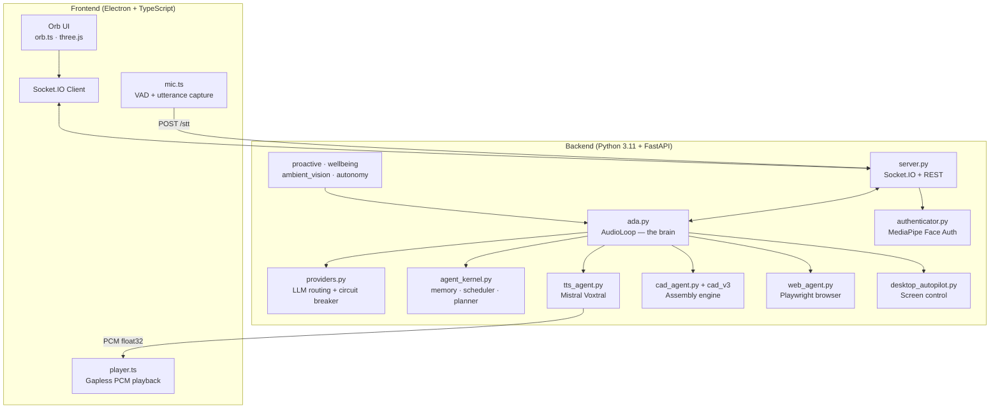

# A.D.A V2 - Advanced Design Assistant


> **A.D.A** = **A**dvanced **D**esign **A**ssistant

ADA V2 is a desktop AI assistant with a real-time voice loop, ambient awareness, and a
parametric CAD engine. Speech **in** is Groq Whisper; speech **out** is **Mistral Voxtral**
— one fixed voice, "Jane", with real barge-in. Around that sit persistent memory, a
scheduler, an autonomy ladder, and a 3D assembly engine that designs parts from a sentence.

---

## 🌟 Capabilities at a Glance

| Feature | Description | Technology |
|---------|-------------|------------|
| **🗣️ Low-Latency Voice** | Streaming conversation with word-level barge-in | Groq Whisper (STT) → Mistral Voxtral (TTS) |
| **🧊 Assembly CAD** | Multi-part designs from a sentence, with real mates | `cad_v3` engine on build123d / OCCT |
| **🖨️ 3D Printing** | Slicing and wireless print job submission | OrcaSlicer + Moonraker/OctoPrint |
| **🔮 Reactive Orb UI** | Particle orb that follows voice, thinking and playback | TypeScript + three.js |
| **👁️ Face Authentication** | Secure local biometric login | MediaPipe Face Landmarker |
| **🌐 Web Agent** | Autonomous browser automation | Playwright + Chromium |
| **🧠 Persistent Memory** | Facts, episodes and an entity graph across sessions | SQLite kernel + embeddings |
| **⏰ Scheduler & Proactivity** | Reminders, recurring tasks, unprompted lines | `agent_kernel` + `proactive.py` |
| **🛡️ Autonomy Ladder** | Four authority levels; L3 armed by a spoken ritual | `autonomy.py` |
| **🖥️ Desktop Autopilot** | Screenshot → act → verify, with a corner-slam kill switch | `pyautogui` + vision model |
| **📓 Overnight Dossier** | Research while you sleep, briefed when you wake | `overnight_dossier.py` |
| **🌅 Ambient Vision** | Periodic one-line read of the room | `ambient_vision.py` |

---

## 🏗️ Architecture Overview



---

## ⚡ TL;DR Quick Start (Experienced Developers)

<details>
<summary>Click to expand quick setup commands</summary>

```bash
# 1. Clone and enter
git clone https://github.com/nazirlouis/ada_v2.git && cd ada_v2

# 2. Create Python environment (Python 3.11)
conda create -n ada_v2 python=3.11 -y && conda activate ada_v2
brew install portaudio  # macOS only (for PyAudio)
pip install -r requirements.txt
playwright install chromium

# 3. Setup frontend
npm install

# 4. Create .env file
echo "GEMINI_API_KEY=your_key_here" > .env

# 5. Run!
conda activate ada_v2 && npm run dev
```

</details>

---

## 🛠️ Installation Requirements

### 🆕 Absolute Beginner Setup (Start Here)
If you have never coded before, follow these steps first!

**Step 1: Install Visual Studio Code (The Editor)**
- Download and install [VS Code](https://code.visualstudio.com/). This is where you will write code and run commands.

**Step 2: Install Anaconda (The Manager)**
- Download [Miniconda](https://docs.conda.io/en/latest/miniconda.html) (a lightweight version of Anaconda).
- This tool allows us to create isolated "playgrounds" (environments) for our code so different projects don't break each other.
- **Windows Users**: During install, check "Add Anaconda to my PATH environment variable" (even if it says not recommended, it makes things easier for beginners).

**Step 3: Install Git (The Downloader)**
- **Windows**: Download [Git for Windows](https://git-scm.com/download/win).
- **Mac**: Open the "Terminal" app (Cmd+Space, type Terminal) and type `git`. If not installed, it will ask to install developer tools—say yes.

**Step 4: Get the Code**
1. Open your terminal (or Command Prompt on Windows).
2. Type this command and hit Enter:
   ```bash
   git clone https://github.com/nazirlouis/ada_v2.git
   ```
3. This creates a folder named `ada_v2`.

**Step 5: Open in VS Code**
1. Open VS Code.
2. Go to **File > Open Folder**.
3. Select the `ada_v2` folder you just downloaded.
4. Open the internal terminal: Press `Ctrl + ~` (tilde) or go to **Terminal > New Terminal**.

---

### ⚠️ Technical Prerequisites
Once you have the basics above, continue here.

### 1. System Dependencies

**MacOS:**
```bash
# Audio Input/Output support (PyAudio)
brew install portaudio
```

**Windows:**
- No additional system dependencies required!

### 2. Python Environment
Create a single Python 3.11 environment:

```bash
conda create -n ada_v2 python=3.11
conda activate ada_v2

# Install all dependencies
pip install -r requirements.txt

# Install Playwright browsers
playwright install chromium
```

### 3. Frontend Setup
Requires **Node.js 18+** and **npm**. Download from [nodejs.org](https://nodejs.org/) if not installed.

```bash
# Verify Node is installed
node --version  # Should show v18.x or higher

# Install frontend dependencies
npm install
```

### 4. 🔐 Face Authentication Setup
To use the secure voice features, ADA needs to know what you look like.

1. Take a clear photo of your face (or use an existing one).
2. Rename the file to `reference.jpg`.
3. Drag and drop this file into the `ada_v2/backend` folder.
4. (Optional) You can toggle this feature on/off in `settings.json` by changing `"face_auth_enabled": true/false`.

---

## ⚙️ Configuration (`settings.json`)

The system creates a `settings.json` file on first run. You can modify this to change behavior:

| Key | Type | Description |
| :--- | :--- | :--- |
| `face_auth_enabled` | `bool` | If `true`, blocks all AI interaction until your face is recognized via the camera. |
| `tool_permissions` | `obj` | Controls manual approval for specific tools. |
| `tool_permissions.generate_cad` | `bool` | If `true`, requires you to click "Confirm" on the UI before generating CAD. |
| `tool_permissions.run_web_agent` | `bool` | If `true`, requires confirmation before opening the browser agent. |
| `tool_permissions.write_file` | `bool` | **Critical**: Requires confirmation before the AI writes code/files to disk. |

---

### 5. 🖨️ 3D Printer Setup
ADA V2 can slice STL files and send them directly to your 3D printer.

**Supported Hardware:**
- **Klipper/Moonraker** (Creality K1, Voron, etc.)
- **OctoPrint** instances
- **PrusaLink** (Experimental)

**Step 1: Install Slicer**
ADA uses **OrcaSlicer** (recommended) or PrusaSlicer to generate G-code.
1. Download and install [OrcaSlicer](https://github.com/SoftFever/OrcaSlicer).
2. Run it once to ensure profiles are created.
3. ADA automatically detects the installation path.

**Step 2: Connect Printer**
1. Ensure your printer and computer are on the **same Wi-Fi network**.
2. Open the **Printer Window** in ADA (Cube icon).
3. ADA automatically scans for printers using mDNS.
4. **Manual Connection**: If your printer isn't found, use the "Add Printer" button and enter the IP address (e.g., `192.168.1.50`).

---

### 6. 🔑 API Keys
ADA runs on a set of free-tier providers. Two of them are required for her to speak:

- **Mistral** — speech **out** (Voxtral TTS). No key, no voice.
- **Groq** — speech **in** (Whisper STT). No key, she cannot hear you.

The rest are optional and simply skipped when blank:

- **OpenRouter** — the primary brain (free tier, no card).
- **Gemini** — fallback brain, vision, and the browser computer-use agent.
- **NVIDIA NIM** — free-tier fallback for vision and the CAD chain.

1. Create a file named `.env` in the `ada_v2` folder (same level as `README.md`).
2. Copy the contents of `.env.example` into it.
3. Fill in the keys you have:

   ```
   OPENROUTER_API_KEY=...   # primary brain
   MISTRAL_API_KEY=...      # Voxtral TTS — required for speech OUT
   GROQ_API_KEY=...         # Whisper STT — required for speech IN
   GEMINI_API_KEY=...       # fallback brain, vision, browser agent
   NVIDIA_API_KEY=...       # vision + CAD fallback (optional)
   ```

Get keys here: [OpenRouter](https://openrouter.ai/keys) · [Mistral](https://console.mistral.ai) · [Groq](https://console.groq.com/keys) · [Google AI Studio](https://aistudio.google.com/app/apikey) · [NVIDIA NIM](https://build.nvidia.com)

> **Note**: Keep these private! Never commit your `.env` file to Git.

---

## 🚀 Running ADA V2

You have two options to run the app. Ensure your `ada_v2` environment is active!

### Option 1: The "Easy" Way (Single Terminal)
The app is smart enough to start the backend for you.
1. Open your terminal in the `ada_v2` folder.
2. Activate your environment: `conda activate ada_v2`
3. Run:
   ```bash
   npm run dev
   ```
4. The backend will start automatically in the background.

### Option 2: The "Developer" Way (Two Terminals)
Use this if you want to see the Python logs (recommended for debugging).

**Terminal 1 (Backend):**
```bash
conda activate ada_v2
python backend/server.py
```

**Terminal 2 (Frontend):**
```bash
# Environment doesn't matter here, but keep it simple
npm run dev
```

---

## ✅ First Flight Checklist (Things to Test)

1. **Voice Check**: Say "Hello Ada". She should respond.
2. **Vision Check**: Look at the camera. If Face Auth is on, the lock screen should unlock.
3. **CAD Check**: Open the CAD window and say "Create a cube". Watch the logs.
4. **Web Check**: Open the Browser window and say "Go to Google".
5. **Memory Check**: Tell her something durable ("remember I work in metric"), restart, then ask about it.
6. **Quiet Check**: Leave her running while you work. She should stay silent unless something clears her
   rate limits — proactive speech is capped at 3 lines/hour with quiet hours overnight.

---

## ▶️ Commands & Tools Reference

### 🗣️ Voice Commands
- "Remember that [fact]" / "What do you remember about [topic]"
- "Remind me to [task] at [time]"
- "What's on my schedule today?"
- "Pause audio" / "Stop audio"

### 🧊 3D CAD
- **Prompt**: "Design a two-gear reduction box." (multi-part assemblies, real mates)
- **Iterate**: "Make the head thinner." (edits one feature — it does not regenerate)
- **Files**: exported to `projects/cad_exports/<timestamp>_<name>/` as STL + STEP, alongside
  the design spec and the geometry verify report.

### 🖥️ Desktop Autopilot
- **Prompt**: "Open System Settings and turn on Do Not Disturb."
- **Kill switch**: slam the mouse into any screen corner — the run aborts immediately.
- **Gates**: any step the model marks destructive is confirmed out loud before it happens.

### 🌐 Web Agent
- **Prompt**: "Go to Amazon and find a USB-C cable under $10."
- **Note**: The agent will auto-scroll, click, and type. Do not interfere with the browser window while it runs.

### 🖨️ Printing & Slicing
- **Auto-Discovery**: ADA automatically finds printers on your network.
- **Slicing**: Click "Slice & Print" on any generated 3D model.
- **Profiles**: ADA intelligently selects the correct OrcaSlicer profile based on your printer's name (e.g., "Creality K1").

---

## ❓ Troubleshooting FAQ

### Camera not working / Permission denied (Mac)
**Symptoms**: Error about camera access, or video feed shows black.

**Solution**:
1. Go to **System Preferences > Privacy & Security > Camera**.
2. Ensure your terminal app (e.g., Terminal, iTerm, VS Code) has camera access enabled.
3. Restart the app after granting permission.

---

### `GEMINI_API_KEY` not found / Authentication Error
**Symptoms**: Backend crashes on startup with "API key not found".

**Solution**:
1. Make sure your `.env` file is in the root `ada_v2` folder (not inside `backend/`).
2. Verify the format is exactly: `GEMINI_API_KEY=your_key` (no quotes, no spaces).
3. Restart the backend after editing the file.

---

### WebSocket connection errors (1011)
**Symptoms**: `websockets.exceptions.ConnectionClosedError: 1011 (internal error)`.

**Solution**:
This is a server-side issue from the Gemini API. Simply reconnect by clicking the connect button or saying "Hello Ada" again. If it persists, check your internet connection or try again later.

---

## 📸 What It Looks Like

*Coming soon! Screenshots and demo videos will be added here.*

---

## 📂 Project Structure

```
ada_v2/
├── backend/                    # Python server & AI logic
│   ├── ada.py                  # AudioLoop — the brain, tool dispatch, voice loop
│   ├── server.py               # FastAPI + Socket.IO transport
│   ├── agent_kernel.py         # Memory, scheduler, planner, tool forge, audit
│   ├── providers.py            # Multi-provider LLM routing + circuit breaker
│   ├── tts_agent.py            # Mistral Voxtral speech out (streaming)
│   ├── speech_normalizer.py    # Text -> speakable prose
│   ├── cad_agent.py            # CAD orchestrator
│   ├── cad_v3/                 # The assembly engine (spec -> B-rep -> mates)
│   ├── cad_v3_bridge.py        # Orchestrator <-> cad_v3 bridge
│   ├── web_agent.py            # Playwright browser automation
│   ├── desktop_autopilot.py    # Screen control with a corner-slam kill switch
│   ├── authenticator.py        # MediaPipe face auth logic
│   ├── autonomy.py             # Four-level authority ladder
│   ├── proactive.py            # Unprompted speech, rate-limited
│   ├── wellbeing.py            # Desk-time tracking
│   ├── ambient_vision.py       # Periodic one-line read of the room
│   ├── overnight_dossier.py    # 02:00 research run
│   ├── model_surgery.py        # Conversational 3D model editing
│   ├── settings.json           # Tool permissions (auto-synced to the tool registry)
│   └── reference.jpg           # Your face photo (add this!)
├── index.html                  # Single page: orb, transcript, composer, lock screen
├── src/                        # Frontend: TypeScript + Vite + three.js
│   ├── main.ts                 # Wiring: state, transcript, controls, face-auth lock
│   ├── orb.ts                  # The orb (derived from JARVIS, see NOTICE.md)
│   ├── player.ts               # Gapless PCM playback + barge-in anchoring
│   ├── mic.ts                  # Voice activity detection + utterance capture
│   ├── socket.ts               # Socket.IO link and payload types
│   └── style.css               # Layout and palette
├── licenses/JARVIS-LICENSE.txt # Licence that covers the GUI files derived from JARVIS
├── NOTICE.md                   # Attribution and licence summary
├── electron/main.js            # Window & IPC setup, spawns the backend
├── projects/                   # CAD exports (auto-created)
├── _archive/                   # Backups of removed legacy engines (see below)
├── .env                        # API keys (create this!)
├── requirements.txt            # Python dependencies
└── README.md                   # You are here!
```

---

## 🧹 CAD engine consolidation

ADA used to carry **four** CAD implementations. It now carries one.

| Removed | Why |
|---------|-----|
| `backend/cad_v2/` (43 modules) | Preset-driven: keyword regex → hardcoded part lists, including literal `_arc_reactor_parts()`. It could not express a swept impeller or a revolved volute at any level of prompt cleverness, and its `mate_solver` was a 184-line stub whose `"auto"` mode appended a success record and did nothing. |
| `backend/cad_v3_proto/` | The capability spike that proved `build123d`'s `Joint` algebra could do real assembly. Its findings are captured in `ADA_CAD_V3_ASSEMBLY_ENGINE.md`; the code is superseded by `cad_v3/`. |
| `backend/cad_enterprise_bridge.py` | A second, preset-driven guess at the same design. Its output (`payload["enterprise"]`) was never read by the UI. The BOM is now derived from the v3 report directly. |
| `backend/cad_ferrari.py` | Orphaned — imported `cad_v2.planetary_template`, referenced by nothing. |
| `backend/cad_v2/jarvis_cad_engine.py`, `jarvis_copresence.py`, `jarvis_ops.py` | Orphaned — 91 KB+ of unreachable code. `jarvis_ops.py` had no importer anywhere in the repo. |

**Kept and relocated:** `cad_v2/fea_solver.py` → **`cad_v3/fea_solver.py`**. It is the real physics layer
(Von Mises stress, 14-material database, safety factors) and is live on the `/simulate` endpoint,
in `model_surgery`'s silent physics check, and in the overnight diff. Only its location changed.

**Kept as-is:** `cad_agent.py` remains the orchestrator. Its script-writing fallback is *not* a fourth
engine — it is the path that `iterate_cad` depends on, and the documented fallback for decorative
single shapes that have no assembly to speak of.

Everything removed is preserved in **`_archive/`** — both a tarball
(`_archive/ada_cleanup_backup_*.tar.gz`) and a browsable copy under `_archive/removed/`.
This project is not a git repository, so that archive is the only undo. Delete it once you are satisfied.

---

## ⚠️ Known Limitations

| Limitation | Details |
|------------|---------|
| **macOS & Windows** | Tested on macOS 14+ and Windows 10/11. Linux is untested. |
| **Camera Required** | Face auth needs a working webcam. |
| **GUI Scope** | The orb GUI does not yet include the CAD viewer, browser frames, HUD panels, settings menu or hand-gesture control that the earlier React GUI had. |
| **Network Dependency** | No offline mode. Speech (Groq Whisper in, Mistral Voxtral out) and the brain are all remote, so a dropped connection means she goes quiet. |
| **Provider Quotas** | Every provider is on a free tier. Heavy CAD iteration is the usual way to hit a limit; the circuit breaker then falls through to the next provider in the chain. |
| **Wake Word** | Not implemented. She listens only while the app is open and streaming — there is no "Hey Ada" yet. |
| **No Streaming Endpointing** | The frontend captures a whole utterance and posts it, so turn-taking uses a fixed silence window rather than semantic endpointing. |
| **Memory Retrieval** | Search is a brute-force cosine scan with an MD5 bag-of-words fallback embedder. Fine for thousands of entries, not millions. |
| **Single User** | Face auth recognizes one person (the `reference.jpg`). |

---

## 🤝 Contributing

Contributions are welcome! Here's how:

1. **Fork** the repository.
2. **Create a branch**: `git checkout -b feature/amazing-feature`
3. **Commit** your changes: `git commit -m 'Add amazing feature'`
4. **Push** to the branch: `git push origin feature/amazing-feature`
5. **Open a Pull Request** with a clear description.

### Development Tips

- Run the backend separately (`python backend/server.py`) to see Python logs.
- Use `npm run dev` without Electron during frontend development (faster reload).
- The `projects/` folder contains user data—don't commit it to Git.

---

## 🔒 Security Considerations

| Aspect | Implementation |
|--------|----------------|
| **API Keys** | Stored in `.env`, never committed to Git. |
| **Face Data** | Processed locally, never uploaded. |
| **Tool Confirmations** | Write/CAD/Web actions can require user approval. |
| **No Cloud Storage** | All project data stays on your machine. |

> [!WARNING]
> Never share your `.env` file or `reference.jpg`. These contain sensitive credentials and biometric data.

---

## 🙏 Acknowledgments

- **[Google Gemini](https://deepmind.google/technologies/gemini/)** — Native Audio API for real-time voice
- **[build123d](https://github.com/gumyr/build123d)** — Modern parametric CAD library
- **[MediaPipe](https://developers.google.com/mediapipe)** — Face authentication
- **[JARVIS](https://github.com/ethanplusai/jarvis)** by Ethan Rogers — the orb interface the GUI is derived from (non-commercial licence, see [NOTICE.md](NOTICE.md))
- **[Playwright](https://playwright.dev/)** — Reliable browser automation

---

## 📄 License

This project is licensed under the **MIT License**, see the [LICENSE](LICENSE) file.

**Exception:** the GUI files derived from JARVIS (`src/orb.ts`, `src/style.css`) are covered by the JARVIS licence, which allows personal and non-commercial use only. See [NOTICE.md](NOTICE.md) before any commercial use.

---

<p align="center">
  <strong>Built with 🤖 by Nazir Louis</strong><br>
  <em>Bridging AI, CAD, and Vision in a Single Interface</em>
</p>
